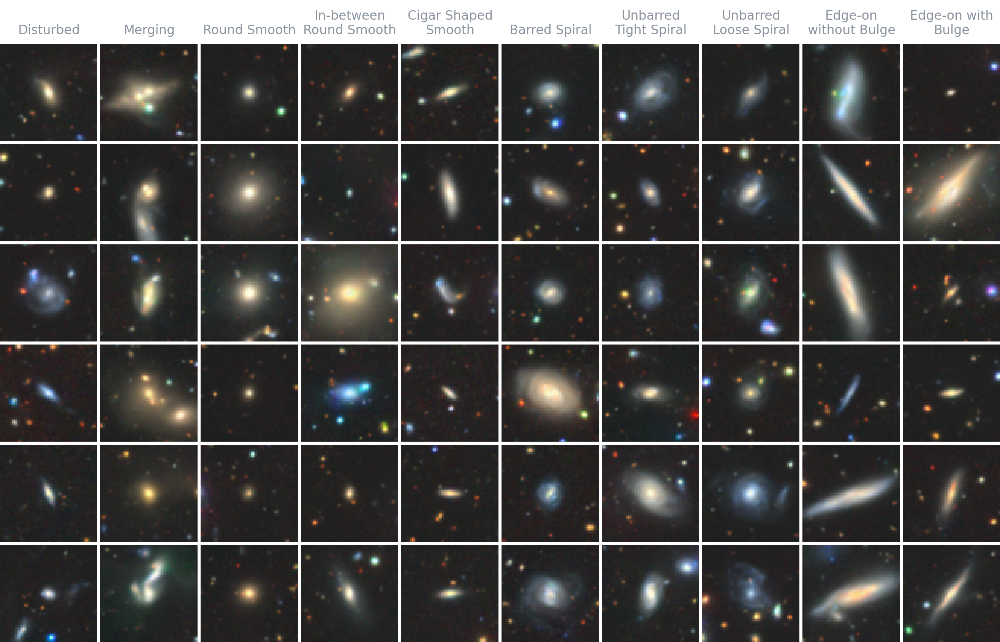
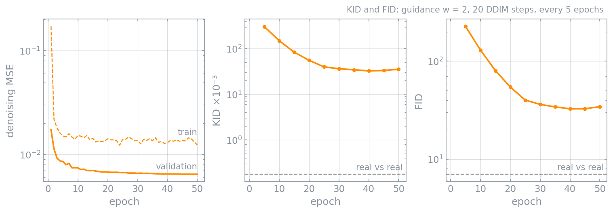
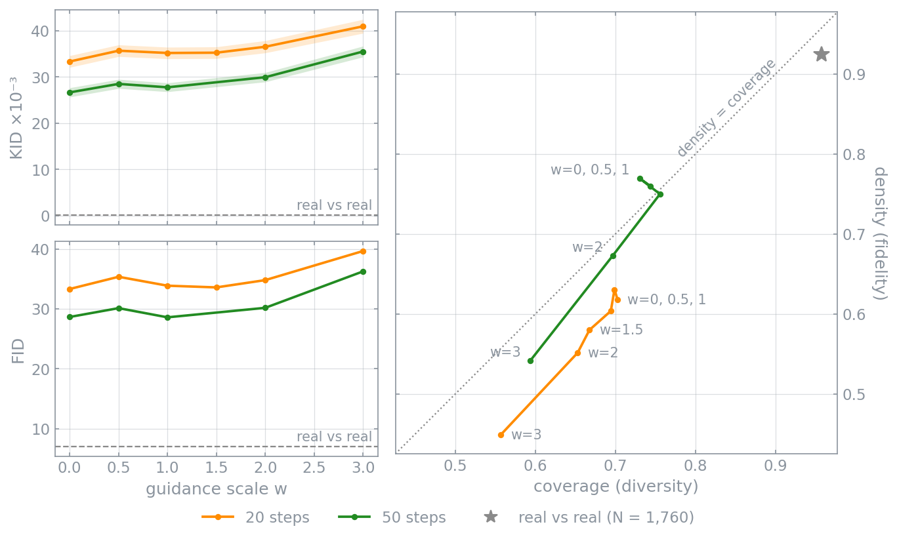
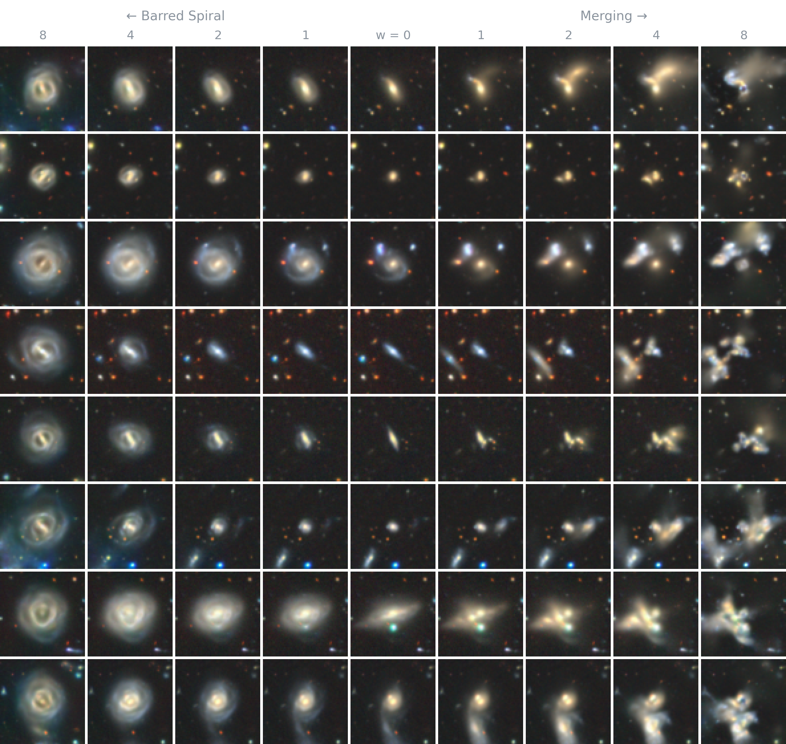
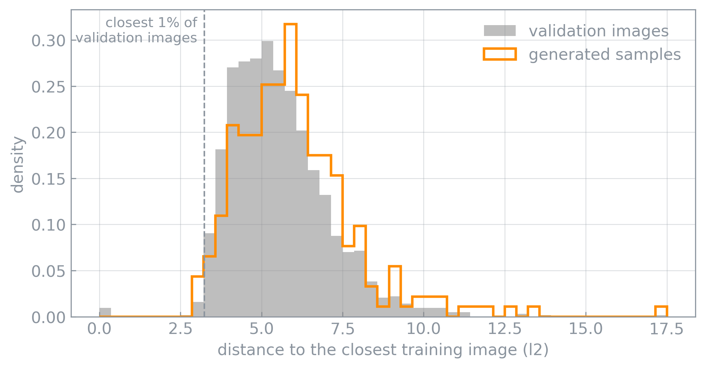

# Galaxy Generation

[](LICENSE)
[](https://huggingface.co/danilobiella/galaxy-generation)
[](https://github.com/danilobiella/galaxy-generation/actions/workflows/test.yml)

A class-conditional diffusion model that generates 64×64 galaxies in the ten
morphological classes of [Galaxy10 DECaLS](https://doi.org/10.5281/zenodo.10845026).
DDPM training, DDIM sampling and classifier-free guidance written from scratch
in JAX + Haiku.



*Uncurated samples, six per class (fixed seed, guidance w = 1, 50 DDIM steps).*

## 0. Setup

```bash
git clone https://github.com/danilobiella/galaxy-generation.git
cd galaxy-generation
pixi install
```

## 1. Data

| | |
|---|---|
| **Source** | Galaxy10 DECaLS: 17,736 RGB images, 10 classes |
| **Augmentation** | random 90° rotations and flips |

```bash
pixi run make data
```

## 2. Training

| | |
|---|---|
| **Model** | U-Net, 51 M parameters: channels 64·(1, 2, 4, 8), ResNet blocks with GroupNorm, bottleneck self-attention
| **Diffusion** | T = 1000, linear β 1e-4 → 0.02, ε-prediction, MSE loss |

```bash
pixi run make smoke         # 2-epoch tiny model, end-to-end check
pixi run python main.py     # full run; RESUME = True in src/config.py continues it
pixi run python -m scripts.plot_training_curves runs/good_run --out assets/training_curves.png
```



## 3. Evaluation



**Guidance.** Same noise per row. w = 0 ignores the label (shared middle column); w grows towards Barred Spiral on the left and Merging on the right.



**Memorisation.** Nearest training image (pixel L2, 8 rotations/flips) for 256
samples, with the validation images as baseline.

| | median distance | closer than 99 % of validation images |
|---|---|---|
| generated | 5.77 | 2.0 % |
| validation | 5.32 | 1 % |



## 4. Serving

Weights: [danilobiella/galaxy-generation](https://huggingface.co/danilobiella/galaxy-generation),
downloaded on first use, SHA-256 pinned.

**CLI**

```bash
pixi run python -m scripts.generate_images -n 10 --seed 42    # classes in turn
pixi run python -m scripts.generate_images -n 10 -c 1         # ten mergers
```

| `-c` | class | `-c` | class |
|---|---|---|---|
| 0 | Disturbed | 5 | Barred Spiral |
| 1 | Merging | 6 | Unbarred Tight Spiral |
| 2 | Round Smooth | 7 | Unbarred Loose Spiral |
| 3 | In-between Round Smooth | 8 | Edge-on without Bulge |
| 4 | Cigar Shaped Smooth | 9 | Edge-on with Bulge |

**HTTP API + web page**

```bash
pixi run make api           # http://127.0.0.1:8000
```

## Tests

```bash
pixi run make test          # CPU only, no weights or data needed
```

## Data and licence

Code: [MIT](LICENSE). Data: Galaxy10 DECaLS by Henry W. Leung and Jo Bovy,
[doi:10.5281/zenodo.10845026](https://doi.org/10.5281/zenodo.10845026), CC BY 4.0.
Labels from [Galaxy Zoo](https://www.zooniverse.org/projects/zookeeper/galaxy-zoo/)
volunteers; images from the [DESI Legacy Imaging Surveys](https://www.legacysurvey.org/).
